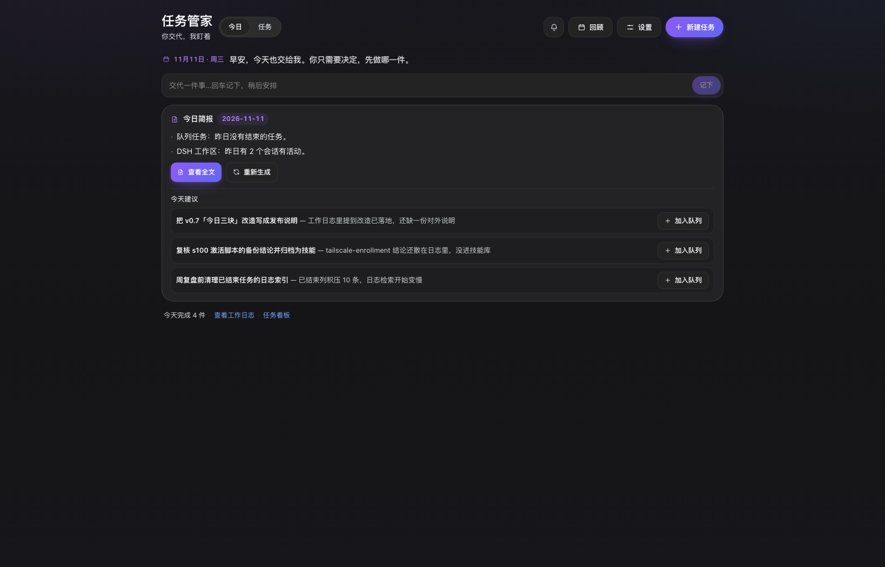
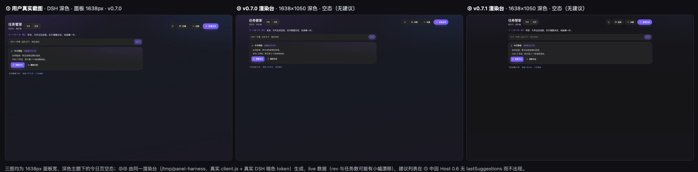
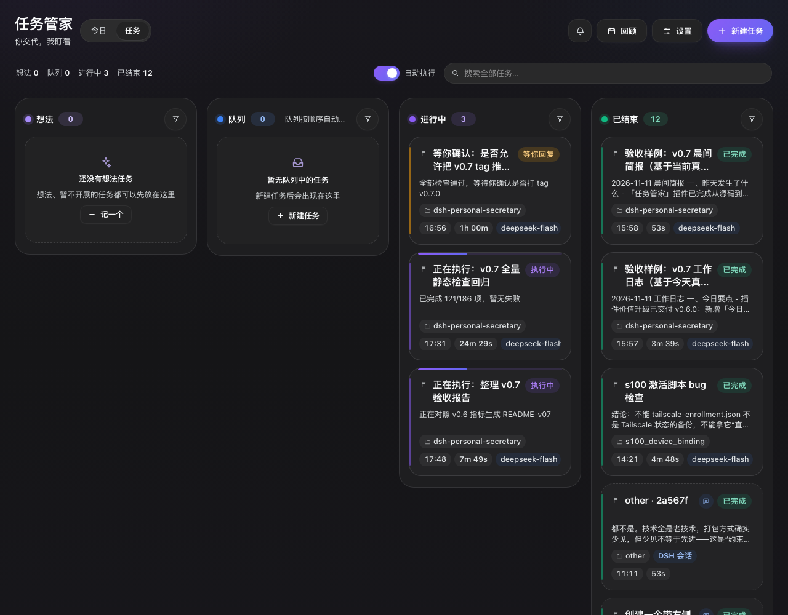
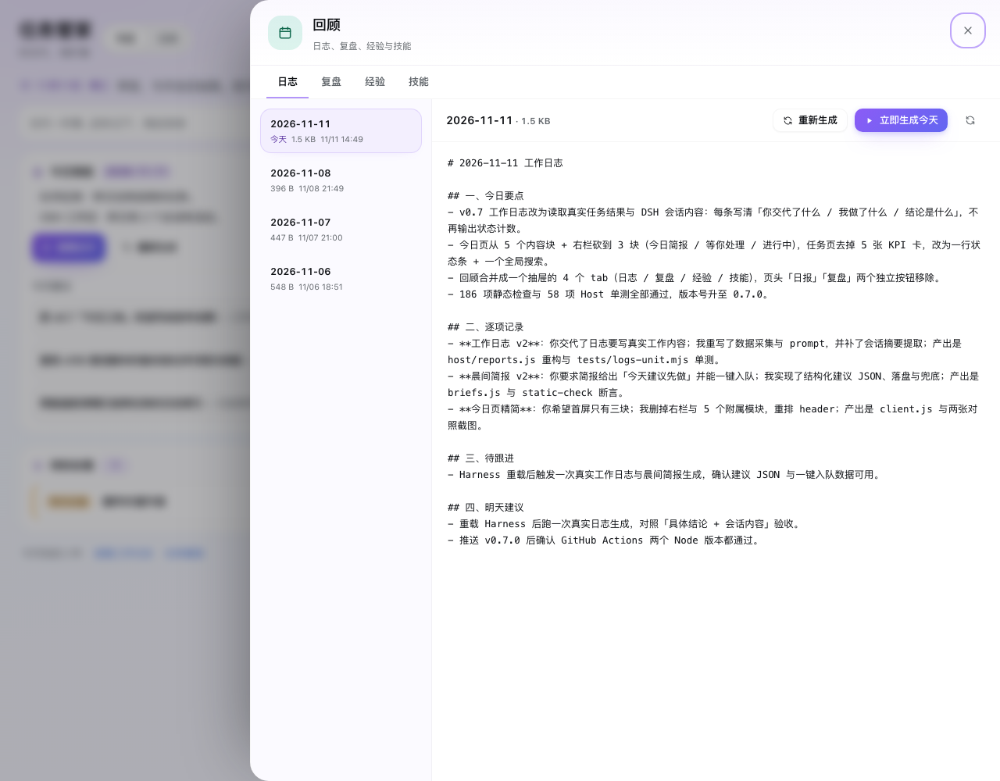

# 任务管家（dsh-task-butler）

[](https://github.com/yan92626/dsh-task-butler/actions/workflows/ci.yml)
[](#license)
[](https://github.com/yan92626/dsh-task-butler)

> 工作日志 + 晨间简报 + 复盘：一个读你真实工作内容、替你记录与回顾的 AI 秘书。

一个 DeepSeek Harness Web 插件（原名「私人秘书」）：把「工作日志、晨间简报、复盘、任务队列」收进一个任务管家面板。

它最有用的地方不是看板，而是**读你真实的工作内容**：工作日志、晨间简报与复盘会读取当天任务的结果、以及 DSH 工作区里会话的真实对话（你交代了什么、最后结论是什么），写成具体、有结论、可回看的日志，而不是「完成 X 项」的状态计数。晨间简报会读完昨天的日志，给出「今天建议先做」并支持**一键加入队列**；复盘会读本期日志，给出带证据的反复问题与下个周期只改的 3 件事。今日页只保留三块：今日简报、等你处理、进行中。

## 为什么需要它

直接开会话适合一次性的交互式工作；任务管家解决的是「**记录、回顾、批量、无人值守、要汇总**」的场景：

1. **工作日志（读真实内容）**：每天固定时间生成一份「今日要点 / 逐项记录 / 待跟进 / 明天建议」的工作日志；会读取任务最终回答与 DSH 会话的真实内容（你问了什么、最后结论是什么），不再只写标题和状态。
2. **晨间简报**：每天 08:30 读昨天的日志与会话，生成「昨天发生了什么 / 今天建议先做 / 等你处理 / 提醒」；「今天建议先做」可以一键加入队列。
3. **复盘**：按每天或每周读取本期工作日志、任务结果与你的纠正，输出「这段时间在做什么 / 反复出现的问题（带证据）/ 有效的做法 / 下个周期只改 3 件事 / 值得固化的规则与技能」。
4. **极简今日页**：只保留三块——今日简报、等你处理（有才出现）、进行中；完整信息在「回顾」与任务页，不在首屏堆卡片。
5. **一句话快捷捕获**：今日页顶部输入一句话、回车即存为「想法」，之后再排期。
6. **任务队列**：批量发布、按全局并发自动领取；**优先级参与入队排序**（紧急 → 高 → 普通 → 低；拖拽/置顶仍可手动覆盖）。
7. **顺序与接力**：任务可「接续上一任务的结果」，方案 → 实现 → 验收这类串行工作自动传递；前置任务没成功，后继不会盲目执行。
8. **结果回收**：每个队列任务沉淀「最终回答 + 耗时 + 轮次 + token 用量」；DSH 工作区里自动归档的会话任务也会回填结果摘要。
9. **会话也归位**：DSH 工作区里的新会话自动成为看板任务（只读），并作为工作日志/复盘的素材。
10. **Webhook 通知**：任务被领取、执行成功、阻塞、失败、晨间简报、工作日志、复盘生成时，按配置把 **Markdown** 消息推送到 Webhook（通用 JSON / 飞书 / 企业微信 / 钉钉 / Slack）；应用内也有通知中心与投递记录。
11. **人工接管**：任务可编辑、可手动执行、可暂停/继续、可停止本轮，自动领取和人工操作随时切换。
12. **经验与技能**：复盘沉淀经验规则（只归档、不注入任务消息）与 Skill 候选，可采用为 DSH skill。

## 界面

- **侧栏入口**：「任务管家」（位于 Plugins 与定时任务之间）。
- **今日页（默认）**：顶部一行问候与日期，下面一句话快捷捕获；然后只有三块：
  - **今日简报**：晨间简报摘要（去 Markdown 的正文要点）+「今天建议先做」列表（每条「做什么 — 为什么」+「加入队列」）；含「查看全文」「重新生成」，以及未生成 / 已关闭 / 旧 Host 四种降级状态；
  - **等你处理**（有内容时才出现）：阻塞 / 暂停 / 失败 / 技能候选，最多 3 条 +「还有 N 条」，可直接打开会话、重试、继续或暂停；
  - **进行中**（有任务时才出现）：一行一条，显示已运行时长与模型，可直接打开会话或暂停。
  - 页脚一行：`今天完成 N 件 · 查看工作日志 · 任务看板`。
- **回顾抽屉（页头「回顾」）**：四个 tab——**日志**（工作日志列表 + Markdown 原文 + 立即生成 / 重新生成）、**复盘**（复盘报告列表 + 立即复盘）、**经验**（经验规则增删启停）、**技能**（候选/已启用技能查看、采纳、启停、删除）；有技能候选待采用时页头「回顾」显示徽标。
- **任务页**：顶部一行状态条（`想法 N · 队列 N · 进行中 N · 已结束 N` + 自动执行开关 + 全局搜索），下面 **想法 / 队列 / 进行中 / 已结束** 四列看板（响应式 4→2→1 列）；列内保留漏斗筛选（状态 / 优先级 / 来源），列头显示 `x/y`。
  - 卡片按状态着色 + 优先级徽章 + 创建/结束时间；上下文与结果摘要会去掉 Markdown 标记，只显示可读文本；模型 / tokens / 轮次等细节收进详情抽屉。
  - 卡片操作按状态提供：立即执行 / 编辑 / 加入队列 / 退回想法 / 暂停 / 继续 / 停止本轮 / 下一个执行 / 重试 / 删除 / 打开会话。
  - 详情抽屉：概览、执行结果（可复制）、操作行、任务对话（可继续对话）；对已完成任务继续对话会让它重新回到进行中。
  - 发布弹窗：单个 / 批量、放入想法（默认）/ 队列、优先级、工作目录、接续上一任务串联。
- **通知中心**：头部铃铛 + 未读数字；popover 内展示「待你处理」与最近 24 小时动态，可「全部标记已读」，底部可打开「通知记录」（Webhook 最近投递：事件 / 时间 / 成功失败 / 错误）。
- **设置弹窗**：执行（并发 / 模型 / 强度 / 自动执行）、桌面提醒、消息推送（Webhook）、**工作日志**（启用 / 时间 / 输出目录 / 最近状态 / 立即生成）、**晨间简报**（启用 / 时间 / 输出目录 / 最近状态 / 立即生成）、**复盘与沉淀**、数据备份。
- **消息推送**：可启用 Webhook、填地址、选消息格式（通用 JSON / 飞书 / 企业微信 / 钉钉 / Slack），按事件开关推送 Markdown；支持「发送测试通知」并显示最近一次发送成功/失败与错误。
  - 渲染适配：飞书/企业微信/钉钉/Slack 只支持有限的 Markdown 语法，发送前会自动转换；每条消息末尾固定带关键词「任务管家」；接收端返回的错误码会被解析并展示。
- 视觉：柔和现代卡片风——大圆角、柔光阴影、粉彩洗底与淡紫/淡蓝环境渐变、紫色渐变主按钮；明暗主题同一语言；`prefers-reduced-motion` 关闭位移动效；响应式、键盘可达。

## 界面预览

以下截图是 v0.7.1 的真实渲染：本地 harness 挂载仓库里的 `client.js` + 真实 DSH 主题 token，数据来自运行中 Host 的只读 `/state`（部分空状态与「今天建议」用演示数据补足，见 `docs/preview/v07/`）。

**今日页**：只有三块——今日简报（含「今天建议」一键加入队列）、等你处理、进行中，加一行页脚；内容列按视图居中（宽屏左右留白对称、与 header 对齐）。



**深色主题改版对照**（用户真实截图 → v0.7.0 → v0.7.1）：内容列从左侧对齐改为居中，深色顶部光晕 chroma −52%、卡片与背景亮度差 +70%、正文对比度 15:1。



**任务页**：一行状态条（想法 / 队列 / 进行中 / 已结束 + 自动执行 + 全局搜索）替代 5 张 KPI 卡，列内搜索框移除、漏斗筛选保留；1280 宽下为真正的四列。



**回顾抽屉**：日志 / 复盘 / 经验 / 技能四个 tab 合并到一个抽屉，页头不再有独立的「日报」「复盘」按钮。



其余对照与状态：`docs/preview/v07/` 下的 `today-before-1280.png` / `tasks-before-1280.png`（v0.6 旧版今日工作台与看板）、`today-1638-dark-rich-v071.png`（三块全在的深色态）、`today-1280-light-v071.png`（浅色）、`today-before-1280-dark.png`（v0.6 深色）等。UI 改动必须按 [`docs/visual-qa.md`](docs/visual-qa.md) 做多宽度 × 明暗 × 空/非空态验收，截图随提交入库。

设计稿：`docs/design/today-mockup.html`（v0.6 的高保真设计稿；v0.7 已按「三块」进一步精简，以真实渲染图为准）。

旧版看板预览：`docs/preview/` 下是 v0.5 时期用真实 DSH 主题 token 渲染的组件预览（列名已更新，仅作历史参考）。

## 数据安全与自动备份

- **自动恢复点**：每次保存前，插件会把上一份 `state.json` 复制到 `<状态目录>/history/`（保留最近 60 份）。误删任务、误改设置后，可在「设置 → 数据备份」里选择最近备份**一键恢复**（恢复前当前数据也会自动备份一份）。
- **自检脚本安全模式**：`tests/api-check.py` 默认只创建并清理它自己的「自检」任务，运行期间临时关闭自动领取，结束时恢复任务顺序与设置；`--dispatch` / `--reorder` / `--reports` / `--briefs` 是需要显式开启的附加项。
- 目录：状态 `<状态目录>/state.json`，恢复点 `<状态目录>/history/state-*.json`。

## 安装

本项目是 **DeepSeek Harness** 的插件 bundle（包名 `dsh-personal-secretary`，界面名「任务管家」，插件行 id `personal-secretary`）。

### 环境要求

- DeepSeek Harness（Web GUI / Desktop），需要 Host 提供 `webServer` 与 `sessionController` 服务。
- 已配置可用的模型（在 Harness 默认模型设置或插件设置里选择）。

### 从 GitHub 安装

1. 打开 Harness → **Plugin Manager**（插件管理）。
2. 选择「安装 Bundle / 安装插件」，粘贴本仓库地址（推荐锁定版本）：

   ```
   github:yan92626/dsh-task-butler#v0.7.1
   ```

   不锁定版本可写 `github:yan92626/dsh-task-butler`。
3. 安装完成后确认 bundle **已启用**，刷新 Harness 页面。
4. 侧栏出现「任务管家」入口；打开设置选择默认模型即可开始使用。

### 本地开发安装

在插件目录执行时可用本地 link 安装（开发调试用）：

```
link:/absolute/path/to/dsh-task-butler
```

或把仓库克隆到 `~/.dsh/profiles/<profile>/` 下再用 Plugin Manager 安装。

### 更新 / 卸载

- 更新：Plugin Manager 里重新安装新的 GitHub 版本（或拉取新 tag），再重新启用一次 bundle；浏览器半刷新页面生效。
- 卸载：Plugin Manager 移除 bundle；任务数据保留在 `<状态目录>/.personal-secretary/state.json`，不会随插件删除。

> 插件代码更新后：Host 半需在 Plugin Manager 里重新启用一次 bundle（或重启 Harness）才会加载新代码；浏览器半在刷新页面后生效。

## 结构

```
index.js            Host 入口：装配存储、会话桥、调度器、工作日志、晨间简报、HTTP API、Agent 工具
host/store.js       队列状态（原子写入 profile 目录）
host/session.js     sessionController 桥：建会话、选模型、投递 prompt、读日志/对话、用量统计
host/scheduler.js   调度器：领取/完成/暂停/阻塞判定、串联门禁、会话结果回填、外部会话同步
host/reports.js     工作日志：真实会话内容采集、AI 生成、本地兜底、文件读写
host/briefs.js      晨间简报：读昨日日志/会话、AI 生成 + 结构化建议、Webhook
host/evolution.js   复盘：读日志与任务结果、定时复盘、经验规则、Skill 沉淀与 runtime provider
host/api.js         同源 JSON API（/secretary/api/*）
host/webhook.js     Webhook 通知：Markdown 模板、格式适配、异步投递与状态记录
host/tool.js        Agent 工具 secretary
client.js           浏览器半：今日页、回顾抽屉、任务看板、通知中心、设置、对话
locale/*.json       Plugin Manager 中的标题与描述（任务管家）
icon.svg            插件图标
tests/              接口自检 + 静态检查 + Host 单测
docs/preview/       界面预览（v0.5 历史图 + v07/ 真实渲染对照）
```

## 数据与路径

- 队列状态：`$DSH_PROFILE_DIR/.personal-secretary/state.json`（Host 进程未暴露 `DSH_PROFILE_DIR` 时回退 `$DSH_HOME/.personal-secretary`）
- 工作日志文件：默认 `<状态目录>/reports/YYYY-MM-DD.md`（可在设置里改目录）
- 晨间简报文件：默认 `<状态目录>/briefs/YYYY-MM-DD.md`（可在设置里改目录）
- 复盘文件：默认 `<状态目录>/evolution/YYYY-MM-DD.md`（可在设置里改目录）
- 经验规则与技能：随 `state.json` 持久化（含自动恢复点），技能以 runtime skill provider 暴露给 DSH 会话

## 核心状态

| 状态 | 界面名 | 含义 | 自动领取 | 可编辑 | 可打开会话 |
|---|---|---|---|---|---|
| idea | 想法 | 想法/暂不开展的任务，暂不执行；可拖到队列 | 否 | 是 | — |
| pending | 队列中 | 已发布、等待领取 | 是 | 是 | — |
| running | 执行中 | 会话正在跑 | — | 否（先暂停） | 是 |
| paused | 已暂停 | 用户暂停了回合 | 否（继续后恢复） | 是 | 是 |
| blocked | 等你回复 | 等待你回答/审批 | 否 | 否 | 是 |
| done / failed / cancelled | 已完成 / 失败 / 已取消 | 历史 | 否（可重试） | 是 | 是（如有会话） |

## 优先级

- 枚举：**紧急 urgent / 高 high / 普通 normal（默认）/ 低 low**。
- **参与入队排序**：任务进入队列（新建到队列、从想法加入队列、重试、修改优先级）时，按 紧急 → 高 → 普通 → 低 插入 pending 队列；同优先级保持原有先后。
- 拖拽排序与「下一个执行」（置顶）是更高优先的**手动覆盖**。

## 工作日志

- 每天到点（默认 21:00，24 小时制 HH:mm，可改）自动生成：**由一个独立的 AI 会话读取当天任务结果与 DSH 会话真实内容**后总结（约 1–3 分钟），固定四段：
  `# YYYY-MM-DD 工作日志` + `一、今日要点` / `二、逐项记录` / `三、待跟进` / `四、明天建议`。
- 数据来源：
  - 队列任务：最终回答 / 错误 / 最近进展；
  - DSH 工作区会话：读取会话记录，提取「你交代了什么 + 最后结论/产出」（最多 8 个会话；超长会话截断）；
  - 当天新建的想法。
- 风格要求：具体、有结论、可回看——允许写结论、数字、文件/文档/链接；不写 token、模型、耗时、路径与会话 ID；不写「完成 X 项」这类状态计数。
- 模型失败或结构不合规时自动回退到 Host 本地汇总；也可在「回顾 → 日志」或设置里「立即生成」。
- 生成完成后会触发 Webhook 的「工作日志」通知。

## 晨间简报

- 每天到点（默认 08:30，HH:mm 可改）自动生成：读**昨天的工作日志**、昨天的会话内容、当前队列/想法/等你处理/进行中，输出固定四段：
  `# YYYY-MM-DD 晨间简报` + `一、昨天发生了什么` / `二、今天建议先做` / `三、等你处理` / `四、提醒`。
- 「今天建议先做」会同时输出结构化建议（1–3 条，含标题、理由、可直接执行的描述、优先级）；今日页的「加入队列」按钮用它一键创建任务。
- 模型失败/结构不合规时回退本地汇总，并用队列/想法兜底出建议；正文 400–700 字，不做状态计数。
- 生成完成后触发 Webhook 的「晨间简报」通知。

## 复盘

- **定时复盘**：默认每天 22:00（可改每周 + 星期）自动触发；也可在「回顾 → 复盘」立即复盘。窗口为「上次成功复盘以来」。
- **数据来源**：本期的工作日志文本、任务真实结果/失败原因、任务会话中你追加的纠正/补充消息、已有经验与技能。
- **固定五段**：`一、这段时间在做什么` / `二、反复出现的问题（带证据）` / `三、有效的做法` / `四、下个周期只改 3 件事` / `五、值得固化的规则与技能`。
- **经验规则（lessons）**：从纠正与失败中提炼可执行规则（最多 40 条），也可手动增删启停；**只归档展示，不注入任务消息**。
- **技能沉淀（skills）**：发现重复/稳定模式时生成 DSH skill 候选（关闭 / 生成候选 / 自动启用三种模式）；已启用技能通过 runtime skill provider 进入 DSH 技能目录，插件重载后从 state 重新注册。
- 复盘报告写入 `<复盘目录>/YYYY-MM-DD.md`；生成完成后触发 Webhook 的「复盘生成」通知。

## HTTP API（浏览器半使用，前缀 `/secretary/api`）

| Method | Path | 说明 |
|---|---|---|
| GET | `/state` | 今日页 / 看板快照（settings 含 `morningBrief.lastSuggestions`、tasks、counts、reports、briefs、evolution 元信息） |
| POST | `/tasks` | 发布任务 `{title,prompt,cwd,group?,chainFrom?,status?:idea\|pending,priority?}` |
| POST | `/tasks/batch` | 批量发布 `{cwd,chain,group,items,status?,priority?}` |
| POST | `/tasks/reorder` | 重排 `{ids}` |
| POST | `/tasks/update` | 编辑任务 `{id,title?,prompt?,cwd?,group?,priority?,chainFrom?}` |
| POST | `/tasks/action` | `{id,action}`：cancel/retry/delete/run-next/run/pause/resume/interrupt/promote/demote |
| POST | `/settings` | 更新设置（含 `dailyReport`、`morningBrief`、`evolution`、`webhook`） |
| GET | `/models` | 模型目录 |
| GET | `/transcript?sessionId=` | 任务会话的对话记录 |
| POST | `/chat` | 任务内继续对话 `{sessionId,text}` |
| POST | `/session/cancel` | 取消某个会话的当前回合 |
| GET | `/reports` | 工作日志列表 |
| GET | `/reports/content?date=` | 某天工作日志内容 |
| POST | `/reports/generate` | 立即生成工作日志 `{date?}` |
| GET | `/briefs` | 晨间简报列表 + 设置 |
| GET | `/briefs/content?date=` | 某天晨间简报内容 |
| POST | `/briefs/generate` | 立即生成晨间简报 `{date?}` |
| GET | `/webhook/log` | Webhook 最近投递记录 |
| POST | `/webhook/test` | 发送一条测试 Markdown 通知 |
| GET | `/evolution` | 复盘/经验/技能总览 |
| GET | `/evolution/content?date=` | 某天复盘 Markdown |
| GET | `/evolution/skills/content?name=` | 某个技能的完整正文 |
| POST | `/evolution/generate` | 立即生成复盘 `{date?}` |
| POST | `/evolution/lessons` / `update` / `delete` | 经验规则增删改 |
| POST | `/evolution/skills/action` | 技能操作 `{name,action}`：adopt/disable/enable/delete |
| GET | `/ping` | 健康检查 |

备份相关 API：`GET /backups` 列出恢复点、`POST /backups/restore {name}` 恢复某个恢复点。

## 自检

```bash
# 端到端接口自检（需要运行中的 Harness；每个任务会真实跑一轮模型）
python3 tests/api-check.py --base http://127.0.0.1:<port>

# 晨间简报 / 工作日志接口自检（会真实生成；需要显式开启）
python3 tests/api-check.py --base http://127.0.0.1:<port> --briefs
python3 tests/api-check.py --base http://127.0.0.1:<port> --reports

# 复盘/经验/技能接口只读自检
python3 tests/api-check.py --base http://127.0.0.1:<port> --evolution

# 打包/清单/浏览器半静态约束自检（无需运行 Harness）
node tests/static-check.mjs

# Host 单测（工作日志/晨间简报/复盘/优先级/存储纯函数，无需运行 Harness）
node --test tests/logs-unit.mjs tests/briefs-unit.mjs tests/evolution-unit.mjs
```

浏览器半另有 jsdom 交互测试（临时环境，不随包分发）。

## 开发与测试

```bash
node tests/static-check.mjs
node --test tests/logs-unit.mjs tests/briefs-unit.mjs tests/evolution-unit.mjs
python3 tests/api-check.py --base http://127.0.0.1:<harness-port>
```

- 技术栈：纯 Node.js（ESM，无构建步骤）+ 单文件浏览器端 `client.js`（`window.__ModuleLoader__` 模块格式，无 JSX）。
- 提交 PR 前请确保 `node tests/static-check.mjs` 与上述单测通过；CI 会在 Node 20/22 上跑同样的检查。
- **UI 改动必须按 [`docs/visual-qa.md`](docs/visual-qa.md) 做视觉验收**：多宽度 × 明暗主题 × 空/非空态截图，检查留白对称、对齐、对比度、字号、横向溢出与 console error；截图随提交放入 `docs/preview/`，不通过不提交、不发版。

## 贡献与许可

- 欢迎提 Issue / PR：功能建议、Bug 复现、文档改进都可以。
- 本项目使用 [MIT License](LICENSE)。

## 已知边界

- 调度器、工作日志、晨间简报与复盘的定时器运行在 Host 进程内：Harness 关闭时不执行，重新打开后继续（晨报只补当天，不补历史）。
- 工作日志 / 晨间简报 / 复盘都是 AI 生成：模型失败/超时/结构不合规时用 Host 本地兜底，兜底质量低于 AI 输出。
- 工作日志与晨报读取会话内容时会截断超长会话（每会话「首条消息 + 最后结论」），极长会话只能看到最后结论。
- 会话被删除后无法读取其内容（无法写入日志/复盘）。
- 「等你回复」（blocked）依据会话日志里未回答的 `ask_user_question` 判定；审批类等待可能显示为执行中。
- 优先级参与的是**入队插入排序**；用户拖拽 /「下一个执行」是更高优先的手动覆盖。
- 经验规则默认不注入任务消息；技能是插件进程内的 runtime skill provider，不写入用户级/项目级 skills 目录。
- 「自动启用」技能模式可能引入不理想的技能；默认「生成候选」人工采纳。
- 通知中心是 `/state` 派生的最近动态与未读数，不是持久事件流。
