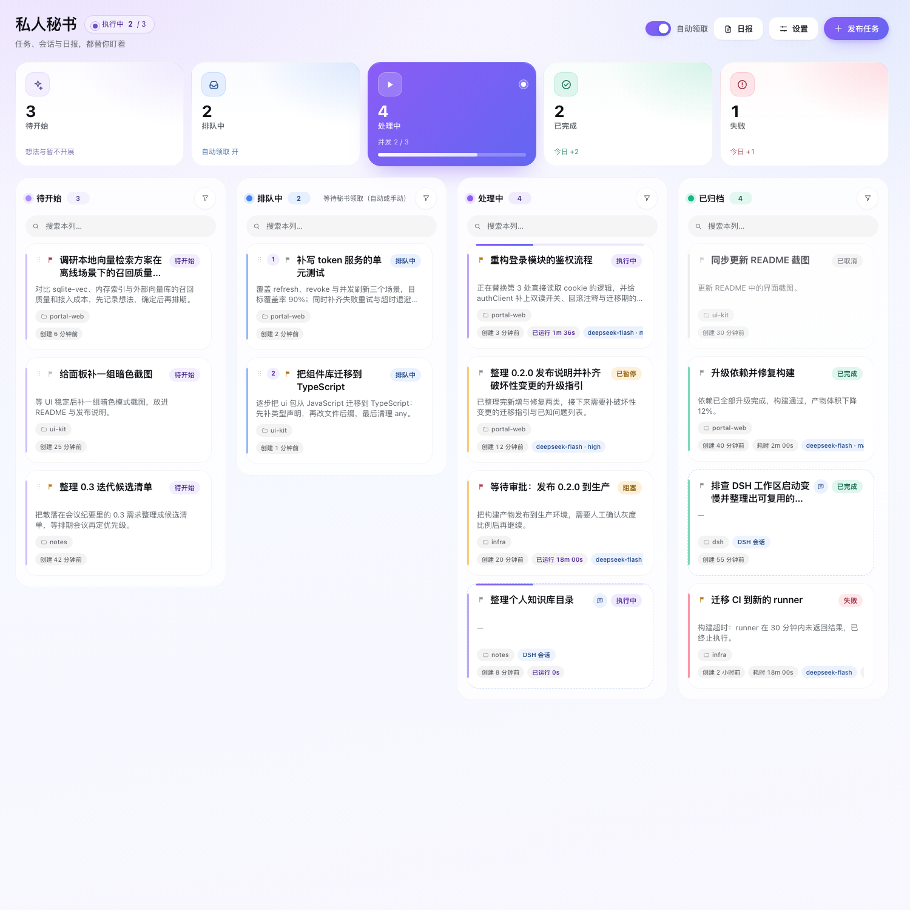

# 任务管家（dsh-task-butler）

[](https://github.com/yan92626/dsh-task-butler/actions/workflows/ci.yml)
[](#license)
[](https://github.com/yan92626/dsh-task-butler)

> 任务队列 + 执行看板 + 日报 + 复盘，一个插件管住「批量、无人值守、要汇总」的工作。

一个 DeepSeek Harness Web 插件：把「任务、会话、日报、自我进化」收进一个任务管家面板（原名「私人秘书」）。发布任务后由系统按全局并发自动领取执行；DSH 工作区里新建的会话也会自动归档到看板；任务可编辑、可暂停/继续/打断、可手动执行；每天按固定格式自动生成工作日报；还会定时复盘任务与你的纠正，沉淀经验规则供查阅、把重复流程沉淀为 DSH skill。

## 为什么需要它

直接开会话适合一次性的交互式工作；任务管家解决的是「**批量、无人值守、有顺序、要汇总**」的场景：

1. **批量发布、自动排队**：一次贴进 N 个任务（或让 Agent 用 `secretary` 工具把活拆进队列），按全局并发自动领取。
2. **顺序与接力**：任务可「承接上一任务的结果」，把方案 → 实现 → 验收这类串行工作交给队列自动传递；前置任务没成功，后继不会盲目执行。
3. **统一执行口径**：所有任务共用默认模型、思考强度、并发上限与工作目录策略，结果可复现、可比。
4. **结果回收**：每个任务沉淀「最终回答 + 耗时 + 轮次 + token 用量」，看板与详情直接查看。
5. **会话也归位**：在 DSH 里新开的会话（无论是否由插件发起）自动成为看板任务，历史状态不再丢。
6. **日报总结**：每天固定时间自动汇总「今天做了哪些任务、当前进度/状态」，按固定四段格式写入 `YYYY-MM-DD.md`，在插件里直接查看。
7. **Webhook 通知**：任务被领取、执行成功、阻塞、失败以及每天日报生成时，按配置把 **Markdown** 消息推送到你的 Webhook（支持通用 JSON / 飞书 / 企业微信 / 钉钉 / Slack 格式）。
8. **人工接管**：任务可编辑、可手动执行、可暂停/继续/打断，自动领取和人工操作可以随时切换。
9. **自我进化 / 复盘**：默认每天 22:00（可改每周）自动复盘：读取任务结果、失败原因和任务会话中你追加的纠正，沉淀成**经验规则**（只归档展示，不注入任务消息）；发现重复/标准化任务时输出 **Skill 候选**，可采用为 DSH skill（默认人工确认，也可自动启用）。

## 界面

- **侧栏入口**：「任务管家」（位于 Plugins 与定时任务之间）。
- **柔和统计条**：5 张粉彩卡片——待开始（淡紫）/ 排队中（淡蓝）/ 处理中（深紫渐变 hero 卡 + 进度条）/ 已完成（薄荷）/ 失败（玫红）；柔光阴影、圆角图标砖、友好大数字，悬停轻浮起。
- **视觉风格**：整体为柔和现代卡片风——大圆角（20–24px）、多层柔光阴影、粉彩洗底与淡紫/淡蓝环境渐变、粉彩胶囊标签与紫色渐变主按钮；明暗主题同一语言；`prefers-reduced-motion` 关闭位移动效。
- **看板**：**待开始 / 排队中 / 处理中 / 已归档** 四列卡片看板（响应式 4→2→1 列）；卡片按状态着色（待开始、排队中、执行中、已暂停、阻塞、已完成、失败、已取消、DSH 会话各不相同）+ **优先级徽章**（紧急/高/普通/低）+ 创建时间（hover 看完整时间），hover 有上浮、状态色阴影与高光动效。
- **待开始**：暂不执行的想法/待明确任务放这里，可随时编辑；**把卡片拖到「排队中」列**即进入自动领取队列（「排队中」拖回「待开始」则退回）；新建任务默认进入待开始，发布弹窗可选择直接放入排队中。
- **列内筛选与搜索**：每列独立的紧凑搜索框（标题/描述/目录/会话 ID）+ 筛选弹层（状态 / 优先级 / 来源 DSH 会话 / 清除），列间互不影响；筛选后列头显示 `x/y`，无匹配有列内空状态。
- **任务卡操作**：按状态给出「执行 / 编辑 / 移入排队中 / 移回待开始 / 暂停 / 继续 / 打断 / 置顶 / 重试 / 删除 / 打开会话」。
- **详情抽屉**：概览、执行结果（可复制）、操作行、任务对话（可继续对话）。
- **对话重开任务**：对已完成/失败/已取消/已暂停的任务继续对话时，任务会**重新回到「处理中」**（会话可用时直接续跑新一轮，结束后自动回到「已归档」并更新结果）；若原会话不可用，则把追加要求并入任务内容、重新回到「排队中」等待领取。
- **发布弹窗**：单个 / 批量、「放入」待开始（默认）/ 排队中、**优先级选择**、工作目录选择、承接上一任务串联。
- **设置弹窗**：宽 720px、两列对齐布局，分区展示执行（并发/模型/强度/自动领取）、通知、**消息通知（Webhook）**、日报、**自我进化**与数据备份。
- **Webhook 消息通知**：设置里可启用 Webhook、填地址、选消息格式（通用 JSON / 飞书 / 企业微信 / 钉钉 / Slack），按事件开关（任务被领取 / 执行成功 / 任务阻塞 / 任务失败 / 日报生成 / 复盘生成）推送 **Markdown** 内容；支持「发送测试通知」，并显示最近一次发送成功/失败与错误。
  - 渲染适配：飞书/企业微信/钉钉/Slack 只支持有限的 Markdown 语法，发送前会自动转换（标题→粗体、列表→圆点、去掉分割线与引用符、剥离代码围栏），避免出现未渲染的 `##`、`---` 原文；每条消息末尾固定带关键词「任务管家」以适配关键词安全校验；接收端返回的错误码会被解析并展示。
  - 交互逻辑：启用开关只控制「是否推送」，**关闭状态下也可以先填写地址、选择格式与事件并发送测试**；开启时若地址为空会就地提示并把焦点移到地址输入框，不会出现"想填地址必须先开启、想开启又必须先填地址"的死锁。
- **日报抽屉**：日期列表 + Markdown 原文 + 立即生成/重新生成；设置区可配置启用、执行时间（HH:mm）、输出目录。
- **复盘抽屉**：三个标签页——**复盘**（历史复盘报告 Markdown + 立即复盘）、**经验**（经验规则列表，可新增/启用/停用/删除）、**技能**（候选/已启用技能，可查看、采用、启用/停用、删除）；页头「复盘」按钮在有技能候选待采用时显示徽标。
- **设置 → 自我进化**：启用开关、每天/每周与 HH:mm 时间、星期（每周时）、技能沉淀模式（关闭/生成候选/自动启用）、复盘输出目录、最近状态与「立即复盘」。
- 明暗主题、1240px 居中、响应式、`prefers-reduced-motion`、键盘可达（含拖拽的 Alt+↑↓ 替代）。

## 界面预览



`docs/preview/` 下是用真实 DSH 主题 token 渲染的组件预览（模拟数据，非线上截图）：

- `board-dark.png` / `board-light.png`：四列看板（待开始 / 排队中 / 处理中 / 已归档）；每列自带搜索框 + 筛选漏斗按钮，卡片统一四段式（标题行 / 两行上下文 / 目录·来源行 / 创建·耗时·模型·tokens·轮次行）
- `stats-light.png` / `stats-dark.png`：柔和统计条特写（5 张粉彩卡片 + 深紫渐变「处理中」hero 卡）
- `board-hover-dark.png`：卡片 hover（上浮 + 状态色阴影 + 高光 + 右下浮动操作层）
- `column-filter-open-light.png`：列内筛选弹层（状态 / 优先级 / 来源 / 清除筛选；列头显示 x/y）
- `column-empty-light.png`：列内无匹配结果时的空状态
- `settings-light.png`：设置弹窗（720px，执行/通知/日报/数据备份四区，两列对齐，日报时间 24 小时制）
- `edit-dialog-light.png`：编辑任务弹窗（无分组字段，标题/描述/目录/承接关系）
- `drawer-done-light.png`：已办结任务详情，底部有「发送消息会重新启动该任务」提示（对话可把任务移回处理中）
- `drawer-paused-light.png`：已暂停任务详情，提示「发送消息将继续该任务」
- `settings-webhook-light.png` / `settings-webhook-on-light.png`：设置 →「消息通知」分区（关闭/开启两种状态；关闭时地址、格式、事件与测试仍可编辑）
- `settings-backup-light.png`：设置 →「数据备份」分区（最近恢复点列表、两步确认恢复、覆盖警告）
- `board-2col-light.png` / `board-1col-light.png`：窄屏 2 列 / 1 列布局

## 数据安全与自动备份

- **自动恢复点**：每次保存前，插件会把上一份 `state.json` 复制到 `<状态目录>/history/`（保留最近 60 份，约每份数 KB）。误删任务、误改设置、脚本/测试误操作后，可在「设置 → 数据备份」里选择最近备份**一键恢复**（恢复前当前数据也会自动备份一份，可再次恢复）。
- **自检脚本安全模式**：`tests/api-check.py` 默认只创建并清理它自己的「自检」任务，运行期间临时关闭自动领取（不会启动你原有的待领取任务），结束时恢复你的任务顺序与设置；`--dispatch` / `--reorder` / `--reports` 是需要显式开启的附加项，且会在运行时提示风险。
- 目录：状态 `<状态目录>/state.json`，恢复点 `<状态目录>/history/state-*.json`。

## 安装

本项目是 **DeepSeek Harness** 的插件 bundle（包名 `dsh-personal-secretary`，界面名「任务管家」，插件行 id `personal-secretary`）。

### 环境要求

- DeepSeek Harness（Web GUI / Desktop），需要 Host 提供 `webServer` 与 `sessionController` 服务（当前 DSH 版本均满足）。
- 已配置可用的模型（在 Harness 的默认模型设置或插件内设置里选择）。

### 从 GitHub 安装

1. 打开 Harness → **Plugin Manager**（插件管理）。
2. 选择「安装 Bundle / 安装插件」，粘贴本仓库地址（推荐锁定版本）：

   ```
   github:yan92626/dsh-task-butler#v0.5.0
   ```

   不锁定版本可写 `github:yan92626/dsh-task-butler`。
3. 安装完成后确认 bundle **已启用**，刷新 Harness 页面。
4. 侧栏出现「任务管家」入口；打开设置选择默认模型即可开始发布任务。

### 本地开发安装

在插件目录执行时可用本地 link 安装（开发调试用）：

```
link:/absolute/path/to/dsh-task-butler
```

或把仓库克隆到 `~/.dsh/profiles/<profile>/` 下再用 Plugin Manager 安装。

### 更新 / 卸载

- 更新：Plugin Manager 里重新安装新的 GitHub 版本（或拉取新 tag），再重新启用一次 bundle；浏览器半刷新页面生效。
- 卸载：Plugin Manager 移除 bundle；任务数据保留在 `<状态目录>/.personal-secretary/state.json`，不会随插件删除。

> 插件代码更新后：Host 半需在 Plugin Manager 里重新启用一次 bundle（或重启 Harness）才会加载新代码；浏览器半在刷新页面后生效。

## 结构

```
index.js            Host 入口：装配存储、会话桥、调度器、日报、HTTP API、Agent 工具
host/store.js       队列状态（原子写入 profile 目录）
host/session.js     sessionController 桥：建会话、选模型、投递 prompt、读日志、用量统计
host/scheduler.js   调度器：领取/完成/暂停/阻塞判定、串联门禁、外部会话同步
host/reports.js     日报：数据汇总、定时生成、文件读写
host/evolution.js   自我进化：定时复盘、经验规则沉淀、Skill 沉淀与 runtime skill provider
host/api.js         同源 JSON API（/secretary/api/*）
host/webhook.js     Webhook 通知：Markdown 模板、格式适配、异步投递与状态记录
host/tool.js        Agent 工具 secretary
client.js           浏览器半：看板、筛选搜索、卡片、编辑/日报/复盘弹窗、对话
locale/*.json       Plugin Manager 中的标题与描述（任务管家）
icon.svg            插件图标
tests/              接口自检 + 静态清单检查
docs/preview/       界面预览
```

## 数据与路径

- 队列状态：`$DSH_PROFILE_DIR/.personal-secretary/state.json`（Host 进程未暴露 `DSH_PROFILE_DIR` 时回退 `$DSH_HOME/.personal-secretary`）
- 日报文件：默认 `<状态目录>/reports/YYYY-MM-DD.md`（可在设置里改目录）
- 复盘文件：默认 `<状态目录>/evolution/YYYY-MM-DD.md`（可在设置里改目录）
- 经验规则与技能：随 `state.json` 持久化（含自动恢复点），技能以 runtime skill provider 暴露给 DSH 会话

## 核心状态

| 状态 | 含义 | 自动领取 | 可编辑 | 可打开会话 |
|---|---|---|---|---|
| 待开始 idea | 想法/暂不开展的任务，暂不执行；可拖到排队中 | 否 | 是 | — |
| 排队中 pending | 已发布、等待领取 | 是 | 是 | — |
| 执行中 running | 会话正在跑 | — | 否（先暂停） | 是 |
| 已暂停 paused | 用户暂停了回合 | 否（继续后恢复） | 是 | 是 |
| 阻塞 blocked | 等待你回答/审批 | 否 | 否 | 是 |
| 已完成 done / 失败 failed / 已取消 cancelled | 历史 | 否（可重试） | 是 | 是（如有会话） |

## 优先级

- 枚举：**紧急 urgent / 高 high / 普通 normal（默认）/ 低 low**。
- 只用于展示与筛选（卡片徽章 + 筛选器 + 日报文本），**不参与执行顺序、并发与调度**。

## 日报

- 每天到点（默认 21:00，24 小时制 HH:mm 输入，可改）自动生成：**由一个独立的 AI 会话根据看板数据做总结**（约 1–3 分钟），并强制约束为简洁总结式，固定四段：
  `# YYYY-MM-DD 工作日报` + `一、今日概览` / `二、今日完成` / `三、当前进展与问题` / `四、明日计划`。
- 风格是**总结而不是流水账**：提示词要求每项任务一行、只写状态与一句话进展（≤ ~40 字），不写 token、耗时、模型、路径等技术细节；Host 在写入前还会二次规整（超长条目截断、丢弃技术细节行、每节条数封顶、缺少固定四节时回退为本地汇总），保证内容始终简短可控。
- 数据来源：当天有进展的队列任务、当前未完成任务、待开始任务，以及当天有活动的 DSH 工作区会话（只计数量）。
- 也可在日报抽屉里「立即生成今天」；生成状态（最近生成日期/成功失败/错误）在设置区可见；日报生成时会同步触发 Webhook 的「日报生成」通知。

## 自我进化与复盘

- **定时复盘**：默认每天 22:00（24 小时制 HH:mm 可改，也可设为每周 + 星期）自动触发一次。复盘由一个独立 AI 会话完成（cwd = 复盘输出目录），覆盖「上次成功复盘以来」的任务：任务结果、失败原因、以及任务会话中你后续追加的纠正/补充消息。
- **复盘报告**：写入 `<复盘目录>/YYYY-MM-DD.md`，固定五段：`一、本期概览` / `二、做得好` / `三、错误与用户纠正` / `四、经验规则` / `五、可沉淀为 Skill 的重复模式`；也可在复盘抽屉里「立即复盘」。窗口内没有任何任务活动时不会创建 AI 会话（直接跳过）。
- **经验规则（lessons）**：复盘从用户纠正与失败原因中提炼可执行规则（最多 40 条），也支持在「经验」页手动新增/启用/停用/删除。经验只归档、在「经验」页展示，**不会**再附加到任务消息或 prompt 开头——任务会话里只会出现你自己写的内容；复盘生成的报告与规则用于查阅和人工参考。
- **技能沉淀（skills）**：复盘发现同类任务重复出现或流程稳定时，生成 DSH skill（name/description/whenToUse/正文）。三种模式：`关闭` / `生成候选`（默认，需在「技能」页点「采用」）/ `自动启用`。已启用技能通过插件注册的 runtime skill provider 进入 DSH 全局技能目录，之后任何会话都可按需加载，不必每次把同样指令写进 prompt；技能不写入 `$DSH_HOME/skills` 或项目 `.dsh/skills`，随插件生命周期存在，重启后从 `state.json` 重新注册。
- 复盘生成完成后会触发 Webhook 的「复盘生成」通知；页头「复盘」入口在有技能候选待采用时显示徽标。

## HTTP API（浏览器半使用，前缀 `/secretary/api`）

| Method | Path | 说明 |
|---|---|---|
| GET | `/state` | 看板快照（settings、tasks、counts、reports 与 evolution 精简元信息） |
| POST | `/tasks` | 发布任务 `{title,prompt,cwd,group?,chainFrom?,status?:idea\|pending,priority?}` |
| POST | `/tasks/batch` | 批量发布 `{cwd,chain,group,items,status?,priority?}` |
| POST | `/tasks/reorder` | 重排 `{ids}` |
| POST | `/tasks/update` | 编辑任务 `{id,title?,prompt?,cwd?,group?,priority?,chainFrom?}` |
| POST | `/tasks/action` | `{id,action}`：cancel/retry/delete/run-next/run/pause/resume/interrupt/promote/demote |
| POST | `/settings` | 更新设置（含 `dailyReport`、`evolution`、`webhook`） |
| GET | `/models` | 模型目录 |
| GET | `/transcript?sessionId=` | 任务会话的对话记录 |
| POST | `/chat` | 任务内继续对话 `{sessionId,text}` |
| POST | `/session/cancel` | 取消某个会话的当前回合 `{sessionId}` |
| GET | `/reports` | 日报列表 |
| GET | `/reports/content?date=` | 某天日报内容 |
| POST | `/reports/generate` | 立即生成日报 `{date?}` |
| POST | `/webhook/test` | 发送一条测试 Markdown 通知 |
| GET | `/evolution` | 复盘/经验/技能总览（settings、lessons、skills 元数据、复盘列表、running） |
| GET | `/evolution/content?date=` | 某天复盘 Markdown 内容 |
| GET | `/evolution/skills/content?name=` | 某个技能的完整正文 |
| POST | `/evolution/generate` | 立即生成复盘 `{date?}` |
| POST | `/evolution/lessons` | 新增经验 `{text,category?,scope?,project?}` |
| POST | `/evolution/lessons/update` | 更新经验 `{id,text?,category?,scope?,project?,active?}` |
| POST | `/evolution/lessons/delete` | 删除经验 `{id}` |
| POST | `/evolution/skills/action` | 技能操作 `{name,action}`：adopt/disable/enable/delete |
| GET | `/ping` | 健康检查 |

## 自检

```bash
# 端到端接口自检（需要运行中的 Harness；每个任务会真实跑一轮模型）
# 安全模式：不会删除/修改你已有的任务；只清理本次自检任务并恢复设置
python3 tests/api-check.py --base http://127.0.0.1:<port>

# v9 复盘/经验/技能接口只读自检（插件重新启用后可用；不触发复盘、不花模型时间、不改你的数据）
python3 tests/api-check.py --base http://127.0.0.1:<port> --evolution

# 打包/清单/浏览器半静态约束自检（无需运行 Harness）
node tests/static-check.mjs

# Host 半单元测试（复盘/经验/技能/provider 纯函数与 store 新 API，无需运行 Harness）
node --test tests/evolution-unit.mjs
```

备份相关 API：`GET /backups` 列出恢复点、`POST /backups/restore {name}` 恢复某个恢复点。

浏览器半另有 jsdom 交互测试（临时环境，不随包分发），覆盖看板四列、状态筛选、搜索、发布/批量（含待开始/排队中与优先级）、编辑、跨列拖拽（promote/demote）与键盘替代、暂停/继续/打断、日报列表与生成、设置弹窗、卡片状态色与时间信息、清理等。

## 开发与测试

```bash
# 静态检查（打包结构、浏览器半契约、色板等，无需运行 Harness）
node tests/static-check.mjs

# Host 单元测试（复盘/经验/技能纯函数与 store API）
node --test tests/evolution-unit.mjs

# 端到端接口自检（需要运行中的 Harness，会真实调用模型）
python3 tests/api-check.py --base http://127.0.0.1:<harness-port>
```

- 技术栈：纯 Node.js（ESM，无构建步骤）+ 单文件浏览器端 `client.js`（`window.__ModuleLoader__` 模块格式，无 JSX）。
- 插件结构、状态机、API 契约见代码内注释与 `README` 的「结构」一节。
- 提交 PR 前请确保 `node tests/static-check.mjs` 与 `node --test tests/evolution-unit.mjs` 通过；CI 会在 Node 20/22 上跑同样的检查。

## 贡献与许可

- 欢迎提 Issue / PR：功能建议、Bug 复现、文档改进都可以。
- 本项目使用 [MIT License](LICENSE)。

## 已知边界

- 调度器与日报定时器运行在 Host 进程内：Harness 关闭时不会执行，重新打开后继续。
- 「暂停」= 取消当前回合并保留会话，不会保存模型中间态；「继续」通过向会话追加一条续跑指令实现。
- 「阻塞」依据会话日志里未回答的 `ask_user_question` 判定；审批类等待可能显示为执行中。
- 日报由独立 AI 会话总结生成（约 1–3 分钟）：固定四段、每项一行、只写状态与一句话进展；生成完成后会做格式与长度规整，AI 失败或输出不符合格式时自动回退到 Host 本地汇总，保证始终有一份可读的日报。
- 复盘定时器与日报定时器一样运行在 Host 进程内；Harness 关闭时不执行，重新打开后按 due 规则补跑。
- 复盘是模型总结：模型调用失败时本次复盘失败（不写文件、不更新经验/技能）；模型输出缺少结构化 JSON 时，报告仍可落盘，但经验/技能本次不更新，不会出现半写状态。
- 用户纠正的挖掘依赖任务会话的对话记录（`transcript` 中来源为 user 的追加消息）；会话被删除后无法回溯。
- project 作用域按目录前缀匹配（`task.cwd` 等于或位于 `project` 之下），不做 git 仓库根推断。
- 技能是插件进程内的 runtime skill provider：不写入用户级/项目级 skills 目录；插件重载后从 state 重新注册。
- 「自动启用」模式可能引入不理想的技能；默认用「生成候选」人工采用，出问题可在「技能」页停用或删除。
